# Photoreal Gauge Card

Version 1.5.0

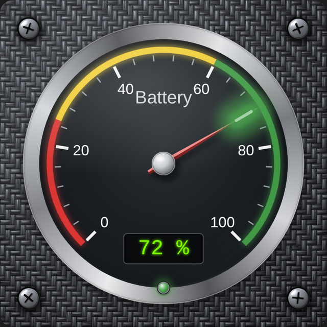

Photoreal Gauge Card is a custom Lovelace card for Home Assistant that draws a realistic analog gauge: a metallic outer ring, a glass-covered dial, a needle with a glowing tip, colored threshold arcs, LED indicators, text labels and LED-style digital displays. Everything can be set from the visual editor, and every field has an info icon that explains it.

**On this page**

- [Install](#install)
- [Add the card](#add-the-card)
- [Using the editor](#using-the-editor)
- [How the gauge is built](#how-the-gauge-is-built)
- [Positions and sizes](#positions-and-sizes)
- [All options](#all-options)
- [Text label tokens](#text-label-tokens)
- [LED conditions](#led-conditions)
- [Use gauge entity](#use-gauge-entity)
- [Examples with pictures](#examples-with-pictures)
- [Fonts](#fonts)
- [Backgrounds and images](#backgrounds-and-images)
- [Troubleshooting](#troubleshooting)
- [Version history](#version-history)

## Install

### With HACS (recommended)

If the card is listed in the HACS store, open **HACS**, search for **Photoreal Gauge Card**, click **Download**, and hard refresh your browser (Ctrl+Shift+R, or Cmd+Shift+R on a Mac).

If it is not listed yet, add it as a custom repository:

1. Open **HACS**, click the three-dot menu at the top right and choose **Custom repositories**.
2. Enter `https://github.com/Muskrat775/photoreal-gauge-card`, set the type to **Dashboard**, and click **Add**.
3. Search for **Photoreal Gauge Card**, click **Download**, and hard refresh your browser.

HACS adds the resource for you. The files are installed to `/config/www/community/photoreal-gauge-card/` and served from `/hacsfiles/photoreal-gauge-card/`, which is the address the example image paths in this guide use. If the card does not show up, check **Settings > Dashboards > Resources** for `/hacsfiles/photoreal-gauge-card/photoreal-gauge-card.js` of type **JavaScript module**.

To update, open HACS, click the card, and choose **Update** (or **Redownload**). Then hard refresh.

### Manual install

You need access to the `/config` folder (File editor, Studio Code Server, Samba, or SSH). No restart is required.

1. Download the `dist` folder from the repository (or the zip from the latest release) and copy its contents into `/config/www/photoreal-gauge-card/`. You end up with this layout:

```
/config/www/photoreal-gauge-card/
    photoreal-gauge-card.js
    README.md
    images/          (pictures used by this guide, plus sample-needle.png)
    backgrounds/     (ready-made square backgrounds)
```

2. Turn on **Advanced mode** in your user profile (click your name at the bottom of the sidebar). Resources are hidden without it.
3. Go to **Settings > Dashboards**, open the three-dot menu at the top right and choose **Resources**.
4. Click **Add resource**, enter this URL and choose **JavaScript module**:

```
/local/photoreal-gauge-card/photoreal-gauge-card.js
```

5. Save, then hard refresh the browser. In the mobile app use **Settings > Companion app > Debugging > Reset frontend cache**.

> If `/config/www` did not exist before, create it and restart Home Assistant once so the `/local/` address becomes available.

Files served from `/config/www/photoreal-gauge-card/` use `/local/photoreal-gauge-card/...` addresses. Wherever this guide shows `/hacsfiles/photoreal-gauge-card/`, use `/local/photoreal-gauge-card/` instead.

> Keep `README.md` in the same folder as the JavaScript file. The **Help** button in the editor loads it from there.

To update manually, replace the files, then hard refresh. If you still see the old version, add `?v=2` to the resource URL (and increase the number on later updates).

## Add the card

1. Open a dashboard, click **Edit dashboard**, then **Add card**.
2. Search for **Photoreal Gauge Card** and select it.
3. Pick an entity and adjust the options in the editor.

Or use YAML in the card's code editor. This is the smallest working card:

```yaml
{type: 'custom:photoreal-gauge-card', entity: sensor.battery_level}
```

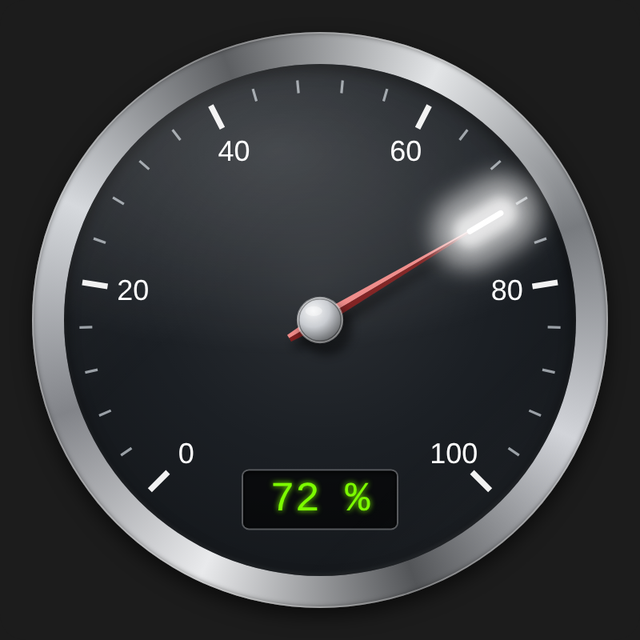

The entity must have a numeric state (or a numeric attribute, set with `attribute`). A more complete example, which is the gauge at the top of this page:

```yaml
type: custom:photoreal-gauge-card
entity: sensor.demo
name: Battery
square_image: /hacsfiles/photoreal-gauge-card/backgrounds/carbon-graphite-screws.jpg
thresholds:
- {from: 0, to: 25, color: '#e53935'}
- {from: 25, to: 60, color: '#fdd835'}
- {from: 60, to: 100, color: '#43a047'}
threshold_glow: true
digitals:
- {y: 76}
labels:
- {text: '{name}', x: 50, y: 30, size: 5.5, color: '#cfd8dc'}
leds:
- x: 50
  y: 88
  size: 3
  conditions:
  - {name: OK, color: '#43a047', behavior: 'on'}
gauge_margin: 7
```

## Using the editor

At the top of the editor there is a **Help** button. It opens this guide in a window on top of the editor.

Next to every field is an **information icon** (an "i" in a circle). Hover over it to see a tooltip, or click or tap it to show the explanation under the field. Click it again to hide it. The icons can be reached with the keyboard and are announced by screen readers.

The editor is organized in groups that you can open and close:

| Group | What it holds |
|---|---|
| Main settings (top) | Entity, name, attribute, unit, min, max, decimals, start and end angle |
| Actions | Tap, hold and double-tap behavior |
| Backgrounds (square & circle) | The square behind the gauge and the round dial face, shading, shadow and glass |
| Gauge outer ring | The metallic ring around the dial, its image and glows |
| Ticks & numbers | Scale marks and numbers |
| Min/max markers | Small triangles for the lowest and highest values |
| Needle | Needle shape and look, plus the glowing tip |
| Center hub | The cap in the middle of the dial |
| Custom fonts | Extra fonts for numbers, labels and digital displays |
| Thresholds | Colored arcs and how they look |
| Text labels | Any number of text labels |
| Digital displays | Any number of LED-style readouts |
| LED indicators | Any number of indicator lights |

Groups with a list (Thresholds, Text labels, Digital displays, LED indicators) have **Add** and **Remove** buttons. Every field you leave at its default is not written to the YAML, so the YAML stays short.

## How the gauge is built

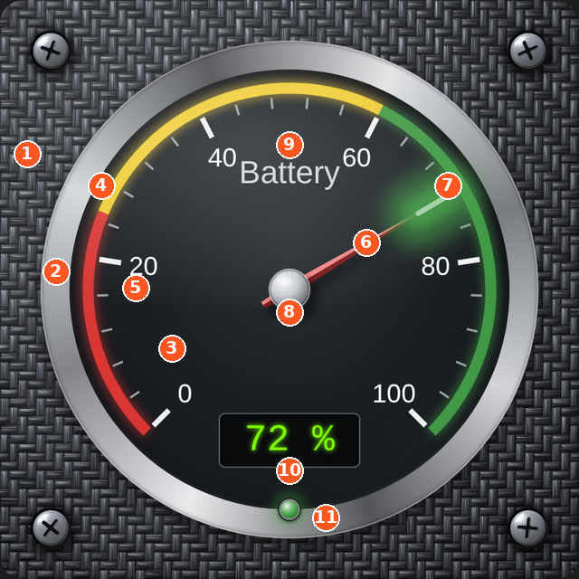

1. **Square background** - the square behind everything (`square_*` options). Add a picture such as the carbon or brushed metal backgrounds.
2. **Gauge outer ring** - the metallic ring, with optional glow and image (`border_*` options).
3. **Circle (dial face)** - the round face inside the ring (`circle_*` options, face shading and glass).
4. **Thresholds** - colored arcs that show ranges such as good, warning and bad.
5. **Ticks and numbers** - major and minor scale marks and the numbers.
6. **Needle** - shape, size, color and opacity.
7. **Needle tip glow** - the glowing line at the end of the needle. It can follow the threshold color.
8. **Center hub** - the cap on the needle pivot.
9. **Text label** - free text, which can show live values.
10. **Digital display** - an LED-style readout of a value.
11. **LED indicator** - a small light that turns on, blinks or fades based on conditions.

## Positions and sizes

Text labels, digital displays and LEDs are placed with **X** and **Y**. These are percentages of the square card:

- X: 0 is the left edge, 50 is the middle, 100 is the right edge.
- Y: 0 is the top edge, 50 is the middle, 100 is the bottom edge.

Items are centered on the position you give them, so very low or very high values cut an item in half at the edge. Keep text near the edge at about 6 to 94.

Sizes (text size, LED size, digital width) are percentages of the card width, so the gauge scales cleanly when you resize the card.

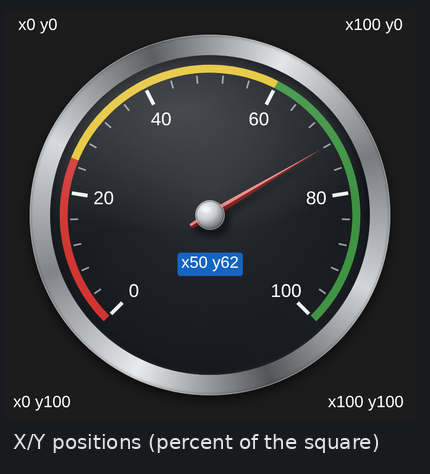

## All options

The tables below list every option, its YAML key and its default. The same explanations appear in the editor's info icons.

### Main settings

| Option | YAML key | What it does | Default |
|---|---|---|---|
| Entity | `entity` | The Home Assistant entity this gauge shows. Its state, or the attribute chosen below, must be a number. | empty |
| Name | `name` | A display name you can insert into text labels with {name}. If empty, the entity's friendly name is used. | empty |
| Attribute | `attribute` | Read this attribute of the entity instead of its state, for example battery_level. Leave empty to use the state. | empty |
| Unit | `unit` | Unit shown after the value in digital displays and in the {unit} label token. If empty, the entity's own unit is used. | empty |
| Min | `min` | The value at the start of the dial, where the needle sits at its lowest position. | `0` |
| Max | `max` | The value at the end of the dial. Must be larger than Min. | `100` |
| Decimals | `decimals` | Number of digits after the decimal point in digital displays and in the {value} label token. | `0` |
| Start angle | `start_angle` | Where the scale begins, in degrees. 0 is straight up and negative values go left. The default -135 starts at the lower left. | `-135` |
| End angle | `end_angle` | Where the scale ends, in degrees. 0 is straight up and positive values go right. The default 135 ends at the lower right. | `135` |

### Actions

| Option | YAML key | What it does | Default |
|---|---|---|---|
| Tap action | `tap_action` | What happens when you tap the gauge. More info opens the entity's detail dialog. | `{"action": "more-info"}` |
| Hold action | `hold_action` | What happens when you press and hold the gauge for half a second. | `{"action": "none"}` |
| Double tap action | `double_tap_action` | What happens when you double-tap the gauge. Setting this adds a short delay before a single tap is acted on. | `{"action": "none"}` |

Actions use Home Assistant's standard action format. Example:

```yaml
tap_action: {action: navigate, navigation_path: /lovelace/energy}
hold_action: {action: more-info}
```

### Backgrounds (square & circle)

| Option | YAML key | What it does | Default |
|---|---|---|---|
| Gauge margin | `gauge_margin` | Empty space between the edge of the square and the outer ring, as a percentage of the card width. Increase it to leave room for outer glow or to shrink the dial. | `5` |
| Square radius | `square_radius` | How rounded the corners of the square background are, as a percentage of the card width. 0 gives sharp corners. | `4` |
| Square color | `square_color` | Fill color of the square behind the dial. By default it matches the dashboard's card background. | dashboard card color |
| Square color opacity | `square_color_opacity` | Opacity of the square's fill color, from 0 (transparent) to 1 (solid). | `1` |
| Square image URL | `square_image` | URL of an image for the square background, for example /hacsfiles/photoreal-gauge-card/backgrounds/carbon-graphite-screws.jpg (HACS) or /hacsfiles/photoreal-gauge-card/backgrounds/carbon-graphite-screws.jpg (manual install). It is scaled to cover the square and drawn over the fill color. | empty |
| Square image opacity | `square_image_opacity` | Opacity of the square background image. Lower it to let the fill color show through. | `1` |
| Circle color | `circle_color` | Fill color of the round dial face inside the outer ring. | `#1b1f24` |
| Circle color opacity | `circle_color_opacity` | Opacity of the dial face color. Lower it to let the square background show through the dial. | `1` |
| Circle image URL | `circle_image` | URL of an image for the dial face, such as brushed metal or a printed dial. It is cropped to the circle. | empty |
| Circle image opacity | `circle_image_opacity` | Opacity of the dial face image. | `1` |
| Face shading | `face_shading` | Adds a soft shaded gradient to the dial face, lighter in the middle and darker at the edge, for depth. | on |
| Shadow | `shadow` | Draws a drop shadow under the outer ring so the gauge looks raised above the background. | on |
| Glass | `glass` | Adds a glass-cover highlight over the dial and needle. | on |
| Glass intensity | `glass_intensity` | How strong the glass highlight is, from 0 (none) to 100. | `40` |

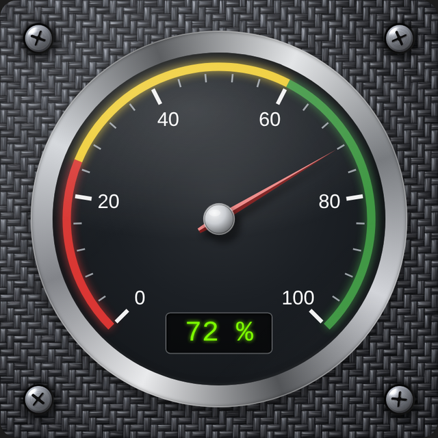

### Gauge outer ring

The ring is the metallic frame around the dial. These options were previously called "Border" in older versions; the YAML keys still start with `border_`, so existing cards keep working.

| Option | YAML key | What it does | Default |
|---|---|---|---|
| Ring color | `border_color` | Base color of the outer ring. With Metallic finish on, it is turned into a polished-metal gradient of this color. | `#b9bdc4` |
| Ring thickness | `border_thickness` | Width of the outer ring as a percentage of the card width. 0 hides the ring. | `5` |
| Ring image URL | `border_image` | URL of an image used instead of the generated ring, such as a photo of a chrome bezel. It overrides ring color and metallic finish. | empty |
| Metallic finish | `border_metallic` | Gives the ring a realistic polished-metal look. Turn it off for a plain two-tone bevel. | on |
| Outer glow color | `border_outer_glow_color` | Color of the glow around the outside of the ring. | `#00b0ff` |
| Outer glow intensity | `border_outer_glow_intensity` | Strength of the outer glow from 0 (off) to 100. Increase Gauge margin if the glow gets clipped. | `0` |
| Inner glow color | `border_inner_glow_color` | Color of the glow just inside the ring, on the dial face. | `#00b0ff` |
| Inner glow intensity | `border_inner_glow_intensity` | Strength of the inner glow from 0 (off) to 100. | `0` |

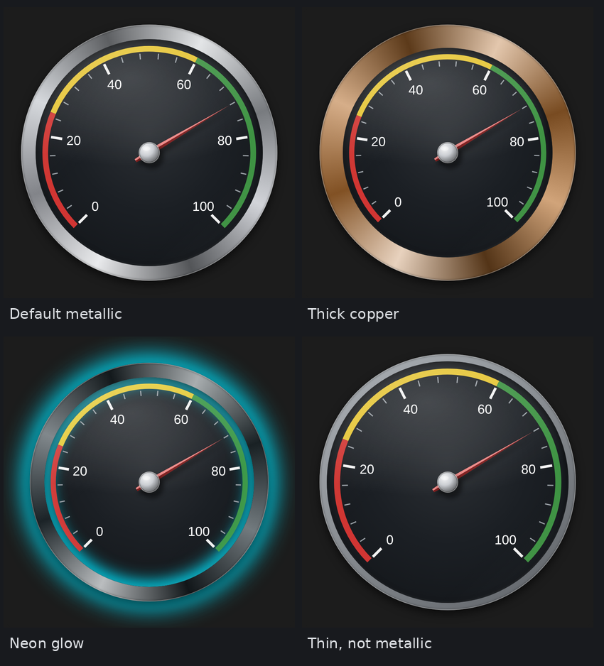

### Ticks & numbers

| Option | YAML key | What it does | Default |
|---|---|---|---|
| Major ticks | `major_ticks` | Number of long, numbered tick marks including the first and last. On a 0 to 100 scale, 6 gives 0, 20, 40, 60, 80 and 100. | `6` |
| Minor ticks | `minor_ticks` | Number of small ticks drawn between each pair of major ticks. | `4` |
| Major tick color | `major_tick_color` | Color of the major tick marks. | `#f2f2f2` |
| Minor tick color | `minor_tick_color` | Color of the minor tick marks. | `#9aa0a6` |
| Major tick length | `major_tick_length` | Length of the major ticks as a percentage of the dial radius. | `10` |
| Minor tick length | `minor_tick_length` | Length of the minor ticks as a percentage of the dial radius. | `5` |
| Major tick width | `major_tick_width` | Thickness of the major tick lines. | `1.8` |
| Minor tick width | `minor_tick_width` | Thickness of the minor tick lines. | `0.8` |
| Show numbers | `show_numbers` | Show the value next to each major tick. | on |
| Number color | `number_color` | Color of the scale numbers. | `#ffffff` |
| Number size | `number_size` | Size of the scale numbers. Try values between 7 and 12. | `9` |
| Number font | `number_font` | Font family for the scale numbers. You can type any font that is installed or loaded under Custom fonts. | `Arial, sans-serif` |
| Number decimals | `number_decimals` | Number of digits after the decimal point in the scale numbers. | `0` |

### Min/max markers

| Option | YAML key | What it does | Default |
|---|---|---|---|
| Show min max | `show_min_max` | Show small triangles on the scale marking the lowest and highest values. | off |
| Min marker color | `min_marker_color` | Color of the min marker triangle. | `#4fc3f7` |
| Max marker color | `max_marker_color` | Color of the max marker triangle. | `#ff7043` |
| Min marker entity | `min_marker_entity` | Optional sensor that supplies the min marker, such as a daily-minimum helper. If empty, the lowest value this browser has recorded for the gauge is used. | empty |
| Max marker entity | `max_marker_entity` | Optional sensor that supplies the max marker. If empty, the highest value this browser has recorded for the gauge is used. | empty |
| Min marker (fixed value) | `min_marker_value` | Fixed value for the min marker. Used when no min entity is set. | empty |
| Max marker (fixed value) | `max_marker_value` | Fixed value for the max marker. Used when no max entity is set. | empty |

For each marker the card uses, in this order: the marker entity, then the fixed value, then the lowest or highest value this browser has recorded for the gauge.

### Needle

| Option | YAML key | What it does | Default |
|---|---|---|---|
| Needle type | `needle_type` | Shape of the needle: Tapered (classic pointer), Line (thin bar), Arrow (arrowhead) or Image (your own picture). | `tapered` |
| Needle length | `needle_length` | How far the needle reaches, as a percentage of the dial radius. | `82` |
| Needle width | `needle_width` | Thickness of the needle at its widest point. | `4` |
| Needle tail | `needle_tail` | How far the needle extends behind the pivot, as a percentage of the dial radius. 0 means no tail. | `14` |
| Needle color | `needle_color` | Main color of the needle. A lighter and a darker shade are added automatically to give it dimension. | `#e53935` |
| Needle opacity | `needle_opacity` | Opacity of the needle body only. The tip glow has its own opacity. | `1` |
| Needle image URL | `needle_image` | URL of a needle picture, a PNG with a transparent background pointing straight up. Used when Needle type is Image. | empty |
| Needle image width | `needle_image_width` | Width of the needle picture. Its height follows Needle length and tail. | `16` |
| Needle shadow | `needle_shadow` | Casts a soft shadow from the needle onto the dial. | on |
| Needle animation (ms) | `needle_animation_ms` | Time the needle takes to swing to a new value, in milliseconds. 0 jumps instantly. | `900` |
| Needle tip glow | `needle_tip_glow` | Adds a small glowing line near the end of the needle. | on |
| Needle tip length | `needle_tip_length` | Length of the glowing line as a percentage of the dial radius. | `14` |
| Needle tip offset | `needle_tip_offset` | How far back from the very end of the needle the glow starts, as a percentage of the dial radius. | `0` |
| Needle tip color | `needle_tip_color` | Glow color. Used when Tip uses threshold color is off, and as the fallback when no threshold matches the value. | `#ffffff` |
| Needle tip opacity | `needle_tip_opacity` | Opacity of the tip glow only. | `1` |
| Needle tip use threshold | `needle_tip_use_threshold` | When on, the glow takes the color of the threshold the value is currently in. | on |
| Needle tip glow intensity | `needle_tip_glow_intensity` | Size and brightness of the halo around the glowing line, from 0 to 100. | `60` |

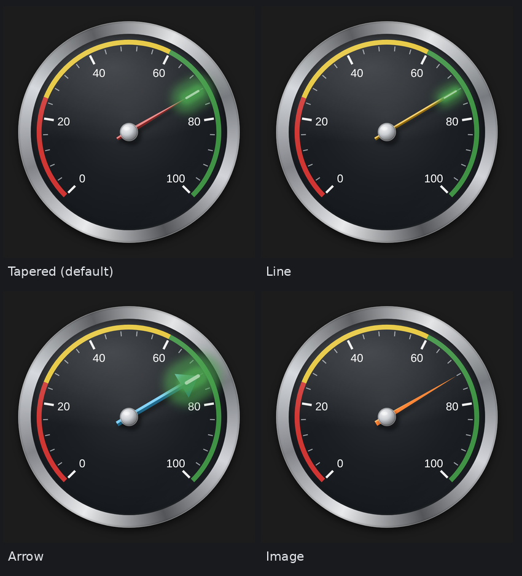

To use your own needle picture, make a PNG with a transparent background, drawn pointing straight up, with the pivot point about 85 percent of the way down. A ready-made example is included as `images/sample-needle.png`:

```yaml
{needle_type: image, needle_image: /hacsfiles/photoreal-gauge-card/images/sample-needle.png, needle_image_width: 14}
```

#### Needle tip glow

The tip glow options are part of the Needle group. With **Tip uses threshold color** on, the glow takes the color of the threshold the value is in.

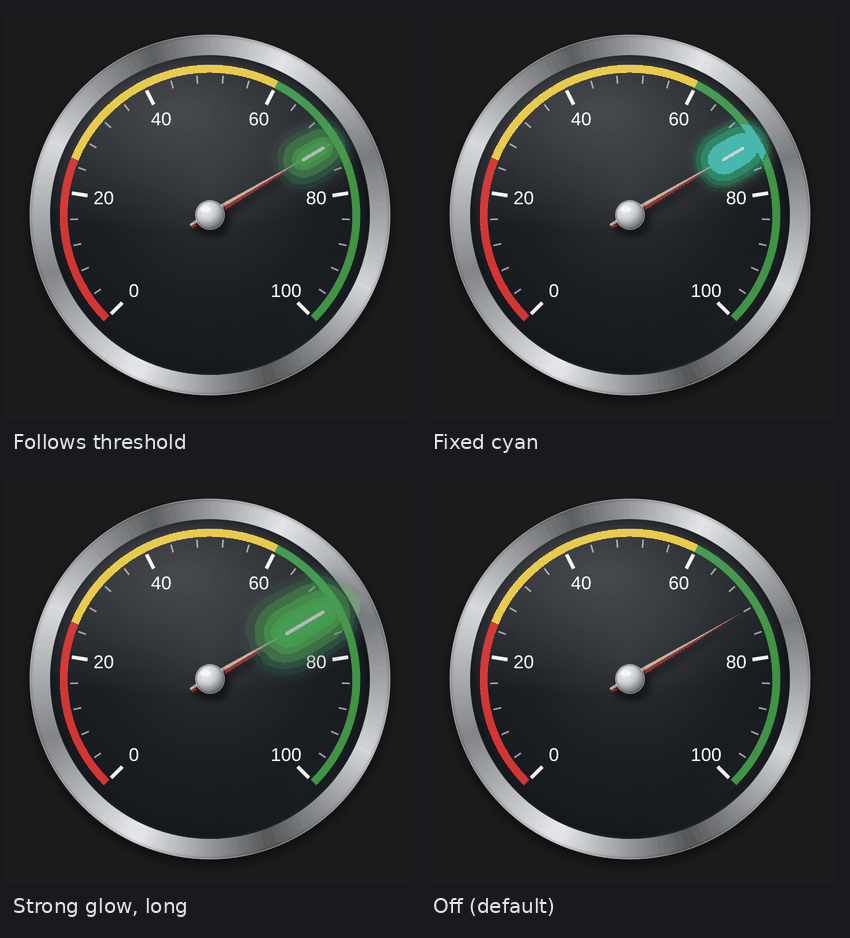

### Center hub

| Option | YAML key | What it does | Default |
|---|---|---|---|
| Hub size | `hub_size` | Radius of the round cap in the middle of the dial. | `7` |
| Hub color | `hub_color` | Color of the hub. Shading is added automatically for a domed metal look. | `#c9ccd1` |
| Hub image URL | `hub_image` | URL of an image for the hub, for example a brushed-metal cap. It is cropped to a circle. | empty |
| Hub opacity | `hub_opacity` | Opacity of the hub. | `1` |

### Custom fonts (YAML lists)

| Option | YAML key | What it does | Default |
|---|---|---|---|
| Font urls | `font_urls` | List of stylesheet URLs to load, such as a Google Fonts link. Example: - https://fonts.googleapis.com/css2?family=Orbitron&display=swap | empty |
| Custom fonts | `custom_fonts` | List of self-hosted fonts. Each item needs family and url, for example family: DSEG7 and url: /local/fonts/DSEG7.woff2. | empty |

### Thresholds

Appearance of all colored arcs:

| Option | YAML key | What it does | Default |
|---|---|---|---|
| Threshold position | `threshold_position` | Place the colored arcs outside the tick marks or inside them. | `outer` |
| Threshold width | `threshold_width` | Thickness of the colored arcs as a percentage of the dial radius. | `5` |
| Threshold opacity | `threshold_opacity` | Opacity of the colored arcs. | `0.9` |
| Threshold glow | `threshold_glow` | Adds a soft glow behind the colored arcs. | off |

Each threshold range (Add threshold):

| Option | YAML key | What it does | Default |
|---|---|---|---|
| From | `from` | Start of the range. The colored arc begins at this value. | empty |
| To (optional) | `to` | End of the range. If empty, the range ends where the next one starts, or at Max for the last one. | empty |
| Color | `color` | Color of the arc, and of the needle tip glow while the value is in this range. | `#43a047` |

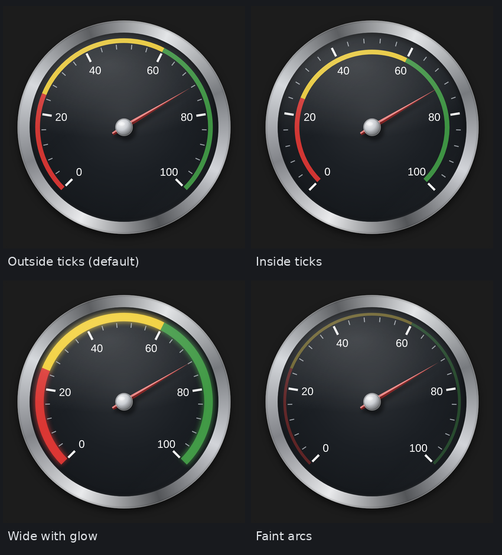

```yaml
thresholds:
- {from: 0, to: 25, color: '#e53935'}
- {from: 25, to: 60, color: '#fdd835'}
- {from: 60, to: 100, color: '#43a047'}
```

### Text labels

Each label (Add label):

| Option | YAML key | What it does | Default |
|---|---|---|---|
| Text | `text` | The text to show. You can use {value}, {unit}, {name} and {state}, which are replaced with live data. | empty |
| X position | `x` | Horizontal position as a percentage of the card width. 0 is the left edge, 50 the centre and 100 the right edge. | `50` |
| Y position | `y` | Vertical position as a percentage of the card height. 0 is the top, 50 the centre and 100 the bottom. | `50` |
| Font size | `size` | Text size as a percentage of the card width. | `5` |
| Rotate | `rotate` | Rotates the label in degrees. Positive values turn it clockwise. | `0` |
| Color | `color` | Text color. | `#ffffff` |
| Font | `font` | Font family. Leave empty to use the scale number font. | empty |
| Weight | `weight` | Normal or bold text. | `normal` |
| Background color | `bg_color` | Color of a box behind the text. Leave unset for no box. | `#000000` |
| Background opacity | `bg_opacity` | Opacity of the box behind the text. Applies to both the box color and the background image. | `1` |
| Background image URL | `bg_image` | URL of an image used as the label's background. | empty |
| Padding | `padding` | Space between the text and the edge of its box. | `0.6` |
| Radius | `radius` | Roundness of the box corners. | `0.8` |
| Use gauge entity | `use_gauge_entity` | Tick (the default) to read {state} from the gauge entity. Un-tick to choose a different entity. | on |
| Entity | `entity` | The entity {state} is read from while Use gauge entity is un-ticked. | empty |
| Attribute | `attribute` | Read {state} from this attribute instead of the state. | empty |

### Digital displays

Each display (Add display). You can add as many as you like, each with its own entity, unit, look and position.

| Option | YAML key | What it does | Default |
|---|---|---|---|
| Use gauge entity | `use_gauge_entity` | Tick (the default) to show the gauge entity. Un-tick to show a different entity. | on |
| Entity | `entity` | The entity this display shows while Use gauge entity is un-ticked. | empty |
| Attribute | `attribute` | Attribute to show instead of the state. | empty |
| Unit | `unit` | Unit shown after the number. If empty, the entity's own unit is used. | empty |
| X position | `x` | Horizontal position as a percentage of the card width. 0 is the left edge, 50 the centre and 100 the right edge. | `50` |
| Y position | `y` | Vertical position as a percentage of the card height. 0 is the top, 50 the centre and 100 the bottom. | `78` |
| Width | `width` | Width of the display box as a percentage of the card width. | `24` |
| Font | `font` | Font for the digits. Type any installed or loaded font family. | `'Courier New', monospace` |
| Font size | `font_size` | Size of the digits as a percentage of the card width. | `6.5` |
| Digit color | `color` | Color of the digits. | `#7CFC00` |
| Glow | `glow` | Adds a soft glow around the digits, like an LED display. | on |
| Background color | `bg_color` | Color of the display's background box. | `#000000` |
| Background opacity | `bg_opacity` | Opacity of the background box color and image. 0 hides the box. | `0.6` |
| Background image URL | `bg_image` | URL of an image for the display's background. | empty |
| Show unit | `show_unit` | Show the unit after the number. | on |
| Decimals | `decimals` | Digits after the decimal point. If empty, the gauge's Decimals setting is used. | empty |
| Text when no data | `no_data_text` | Text shown when the entity is unavailable, unknown or not a number. | `--` |

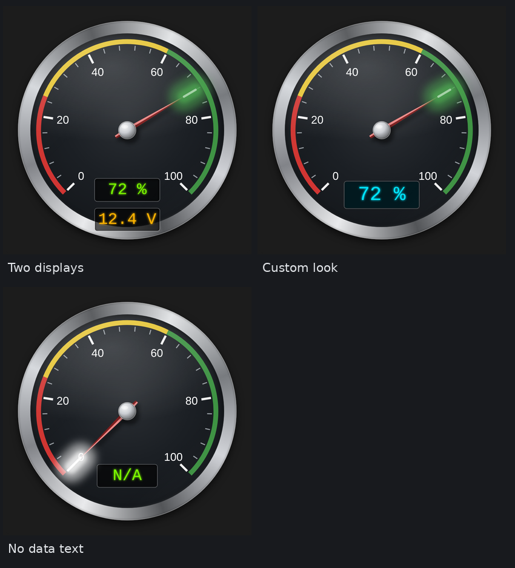

### LED indicators

Each LED (Add LED). Position, size and tooltip name come first, then a **Default color**, then the LED's conditions (see [LED conditions](#led-conditions)):

| Option | YAML key | What it does | Default |
|---|---|---|---|
| X position | `x` | Horizontal position as a percentage of the card width. 0 is the left edge, 50 the centre and 100 the right edge. | `50` |
| Y position | `y` | Vertical position as a percentage of the card height. 0 is the top, 50 the centre and 100 the bottom. | `85` |
| LED size | `size` | Diameter of the LED as a percentage of the card width. | `3` |
| Tooltip name | `label` | Optional name shown as a tooltip when you hover over the LED. | empty |
| Default color (no condition met) | `default_color` | Color of the LED when none of its conditions is met. It is also the starting Off color for every condition. | `#3a0a10` |

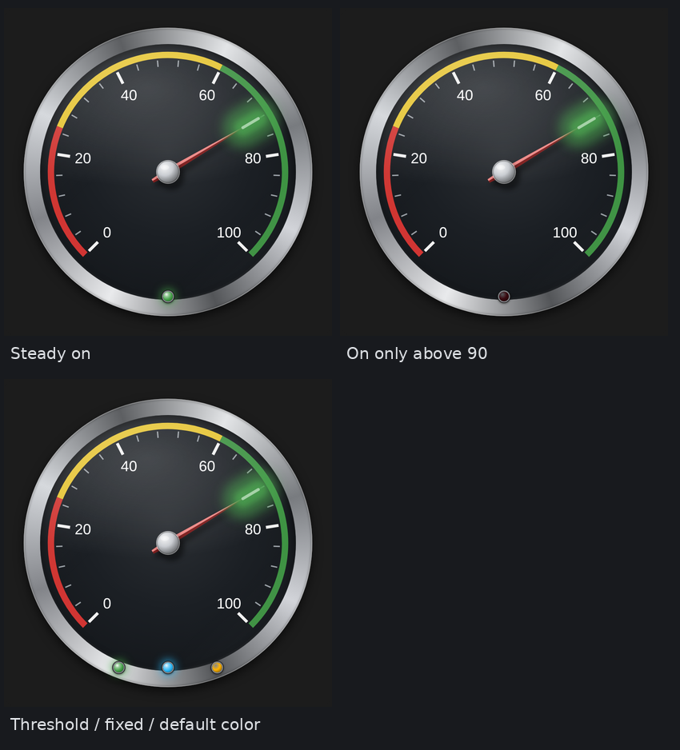

A new LED has no conditions yet, so it shows its default color. Click **Add condition** to make it react.

## Text label tokens

Inside a label's text you can use these tokens. They are replaced with live data:

| Token | Replaced with |
|---|---|
| `{value}` | The gauge value, rounded to Decimals (`--` if not a number) |
| `{state}` | The raw state of the label's own entity and attribute, or of the gauge entity |
| `{unit}` | The unit |
| `{name}` | The gauge name |

Example: `text: "{name}: {value} {unit}"` shows `Battery: 72 %`.

## LED conditions

Every LED has an ordered list of **conditions**. Each condition has its own name, entity, test, colors and behavior. The LED follows **the first condition that is met**, reading from top to bottom, so overlapping conditions never fight. If no condition is met, the LED shows its **Default color**.

Click **Add condition** inside an LED. Give each condition a name (for example *Charging* or *Low battery*). Re-order with the up and down arrows, or drag the handle at the left of the condition. Put the most specific condition first.

| Option | YAML key | What it does | Default |
|---|---|---|---|
| Condition name | `name` | A name for this condition so you can tell them apart, for example Charging or Low battery. | empty |
| Use gauge entity | `use_gauge_entity` | Tick (the default) to check the gauge entity. Un-tick to check a different entity. | on |
| Entity | `entity` | The entity this condition checks while Use gauge entity is un-ticked. | empty |
| Attribute | `attribute` | Attribute to check instead of the state. | empty |
| Operator | `operator` | How to compare: greater than, less than, greater than or equal, less than or equal, equals or not equals. | `above` |
| Value | `value` | The value to compare with. Numbers are compared as numbers, anything else as text. Leave it empty and the condition is always met, which makes a good last 'otherwise' condition. | empty |
| Use threshold color | `use_threshold_color` | When on, the On color is taken from the gauge threshold the value is currently in. | empty |
| On color | `color` | Color of the LED while this condition is met and its behavior is On, Blink or Fade. | `#ff1744` |
| Off color | `color_off` | Color the LED shows for the off part of a Blink or Fade, or when the behavior is Off. If empty, the LED's Default color is used. | the LED's default color |
| LED behavior | `behavior` | What the LED does while this is the first condition that is met. Off shows the Off color. On shows the On color steadily. Blink switches between the On and Off colors. Fade eases between them. | `on` |
| Blink on time (seconds) | `blink_on` | Seconds the On color is shown in each blink. | `0.5` |
| Blink off time (seconds) | `blink_off` | Seconds the Off color is shown in each blink. | `0.5` |
| Fade in time (seconds) | `fade_in` | Seconds to fade from the Off color to the On color. | `1` |
| Fade out time (seconds) | `fade_out` | Seconds to fade from the On color back to the Off color. | `1` |

Operators: Greater than (>), Less than (<), Greater than or equal (>=), Less than or equal (<=), Equals, Not equals. A condition with no value is always met, which makes it a good last "otherwise" condition. If the entity is unavailable, the condition is not met.

**LED behavior**

| Behavior | What the LED shows while the condition is met |
|---|---|
| Off | The Off color. The search stops here, so conditions below are not checked. |
| On | The On color, steady |
| Blink | The On color for the blink on time, then the Off color for the blink off time, repeating |
| Fade | Fades from the Off color to the On color over the fade in time, then back over the fade out time, repeating |

Blink and fade times are shown only when that behavior is selected. Each has separate on and off (or in and out) times, so a quick flash and a slow fade out are possible. If you enable Reduce Motion on your device, blinking and fading are switched off and the On color stays steady.

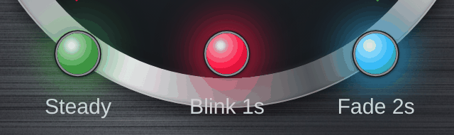

**Example: battery indicator.** Steady green when full, a slow green fade while charging, a fast red blink when low. Because the first met condition wins, a charging battery that is also low shows the fade:

```yaml
leds:
- x: 50
  y: 88
  size: 3
  label: Battery state
  default_color: '#2b2b2b'
  conditions:
  - {name: Full, operator: above_or_equal, value: 100, color: '#43a047', behavior: 'on'}
  - {name: Charging, use_gauge_entity: false, entity: binary_sensor.battery_charging, operator: equals,
    value: 'on', color: '#43a047', color_off: '#0f2a14', behavior: fade, fade_in: 2, fade_out: 1}
  - {name: Low battery, operator: below, value: 20, color: '#ff1744', color_off: '#3a0a10', behavior: blink,
    blink_on: 0.3, blink_off: 0.7}
```

### Upgrading from older versions

LEDs written with the older keys (`above`, `below`, `equals`, `invert`, `effect`, `blink_rate`, ...) still work. When you edit such an LED in the visual editor, it is shown as one condition named *Lit* and saved in the new form.

## Use gauge entity

Digital displays, text labels and LED conditions each have a **Use gauge entity** check box, **on by default**. While it is checked the item uses the gauge's own entity and no entity needs to be chosen. Un-check it to pick a different entity for that item. The **Attribute** field works either way. Items from older configs that already name an entity open with the box un-checked.

In YAML: `use_gauge_entity: false` together with `entity: sensor.other`. The min and max marker entities are not affected: when empty they use the values the gauge has recorded.

## Examples with pictures

### Carbon graphite background with corner screws


```yaml
{square_image: /hacsfiles/photoreal-gauge-card/backgrounds/carbon-graphite-screws.jpg, gauge_margin: 7}
```

### Dark brushed metal

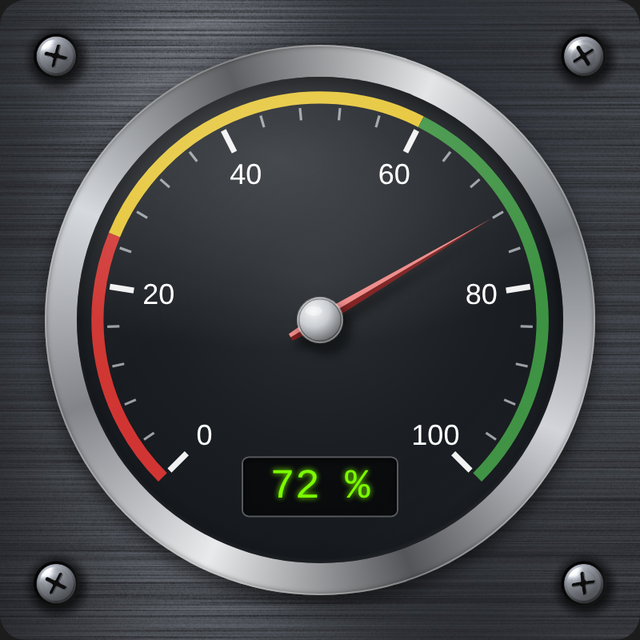

```yaml
{square_image: /hacsfiles/photoreal-gauge-card/backgrounds/dark-brushed-metal-screws.jpg, gauge_margin: 7}
```

A version without screws is `dark-brushed-metal.jpg`:

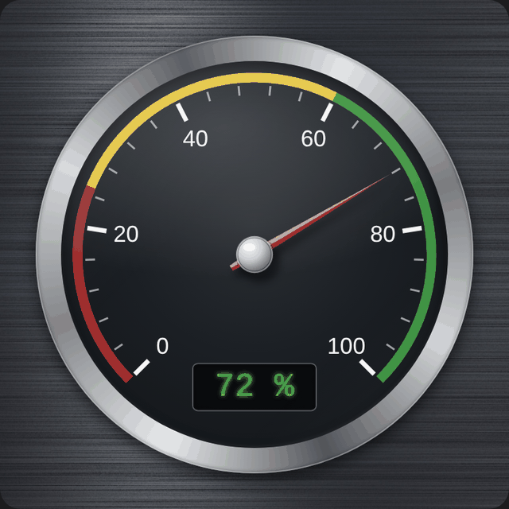

### Neon outer ring

```yaml
{border_color: '#263238', border_outer_glow_color: '#00e5ff', border_outer_glow_intensity: 70, border_inner_glow_color: '#00e5ff',
  border_inner_glow_intensity: 40, gauge_margin: 9}
```

### Two digital displays

```yaml
digitals:
- {y: 74, width: 26}
- {y: 86, width: 26, entity: sensor.voltage, unit: V, color: '#ffb300', decimals: 1}
```

### Temperature gauge

```yaml
type: custom:photoreal-gauge-card
entity: sensor.living_room_temperature
name: Living room
min: 10
max: 35
major_ticks: 6
minor_ticks: 4
decimals: 1
thresholds:
- {from: 10, to: 18, color: '#29b6f6'}
- {from: 18, to: 24, color: '#43a047'}
- {from: 24, to: 30, color: '#fdd835'}
- {from: 30, to: 35, color: '#e53935'}
digitals:
- {}
labels:
- {text: '{name}', x: 50, y: 30, size: 5}
```

## Fonts

Fonts are set per element (scale numbers, labels, digital displays). Choose one from the list or type any font family name. To use a web font, add its stylesheet under **Custom fonts**:

```yaml
font_urls: ['https://fonts.googleapis.com/css2?family=Orbitron&display=swap']
```

To use a font file you host yourself, put it in `/config/www/fonts/` and list it:

```yaml
custom_fonts:
- {family: DSEG7, url: /local/fonts/DSEG7Classic-Regular.woff2}
```

Then enter `DSEG7` as the font of a digital display.

## Backgrounds and images

Any image URL field accepts a path under `/local/` (files in `/config/www/`), a full `https://` address. Backgrounds are scaled to cover the square. Ready-made, dark 1280 by 1280 backgrounds are in the `backgrounds` folder:

| File | Look |
|---|---|
| `carbon-graphite-screws.jpg` | Carbon fiber weave with a screw in each corner |
| `dark-brushed-metal-screws.jpg` | Dark brushed metal with a screw in each corner |
| `dark-brushed-metal.jpg` | Plain dark brushed metal |

Leave a margin around the gauge (**Gauge margin** 6 to 9) so the corner screws stay visible.

## Troubleshooting

| Problem | What to check |
|---|---|
| "Custom element doesn't exist: photoreal-gauge-card" | The resource is not added, has the wrong type (it must be JavaScript module), or the browser cache is old. Check the URL by opening it in a browser tab, then hard refresh. |
| The card shows `--` | The entity is missing, unavailable, or not numeric. Hover over the gauge to see "Entity not found" if the entity ID is wrong. Set `attribute` if the number is an attribute. |
| The Help button says it could not load README.md | `README.md` must be in the same folder as the JavaScript file. Open `/hacsfiles/photoreal-gauge-card/README.md` (HACS) or `/local/photoreal-gauge-card/README.md` (manual) in a browser tab to check. |
| Images do not appear | Check the path. Files in `/config/www/` are served as `/local/...`. Open the image URL in a browser tab to test it. |
| Outer glow is cut off | Increase **Gauge margin** so there is room around the ring. |
| A label or LED is cut in half | Its X or Y is too close to 0 or 100. Items are centered on their position. |
| Changes do not show after an update | Hard refresh. With a manual install you can also add or increase `?v=2` on the resource URL. |
| The needle does not move smoothly | Set **Needle animation (ms)** above 0. The animation is switched off if your device asks for reduced motion. |

## Version history

| Version | Changes |
|---|---|
| 1.5.0 | **Use gauge entity** check box on digital displays, text labels and LED conditions. LED indicators reworked: named, re-orderable conditions (first met wins), each with its own entity, On/Off colors or threshold color, behavior (Off, On, Blink, Fade) and separate blink on/off and fade in/out times. New LED default color. Operators now read Greater than / Less than. Older LED settings still work. Fonts added under Font urls or Custom fonts now appear in the font dropdowns, and a single URL is accepted for Font urls. |
| 1.4.2 | LED blink and fade now cycle between the lit color and the off color instead of fading the whole LED out |
| 1.4.1 | Guide renamed from help.md to README.md, HACS install instructions and `/hacsfiles/` paths |
| 1.4.0 | Info icon on every editor field, Help button with this guide, "Border" group renamed "Gauge outer ring", included example pictures |
| 1.3.0 | LED blink/fade conditions in a dropdown, with AND/OR joins |
| 1.2.0 | Multiple digital displays, "text when no data", LED fade effect with blink and fade rates, first LED conditions, threshold style options moved into Thresholds, needle tip glow moved into Needle |
| 1.1.0 | Color pickers on all color fields, independent needle and tip opacity, working X/Y positions and tip glow |
| 1.0.0 | First version |
