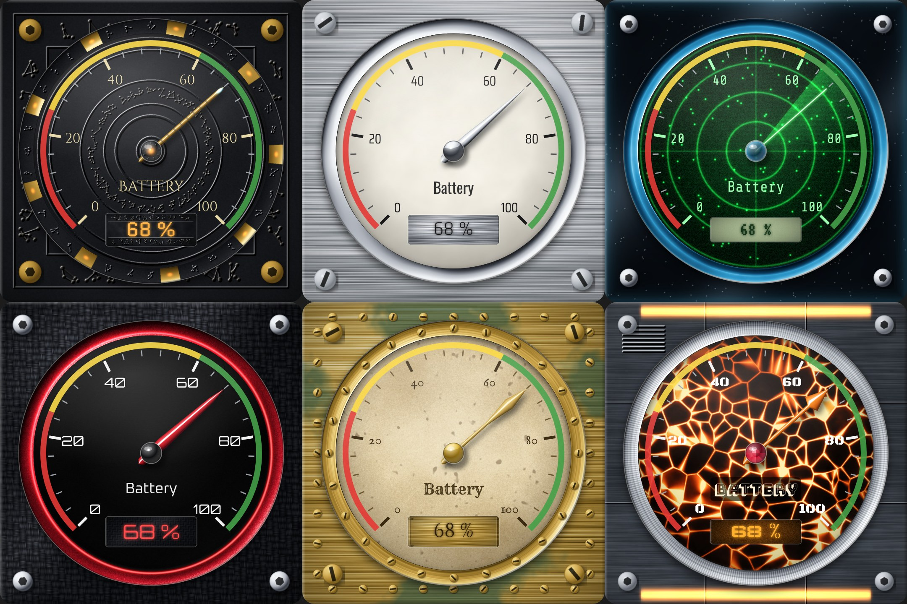
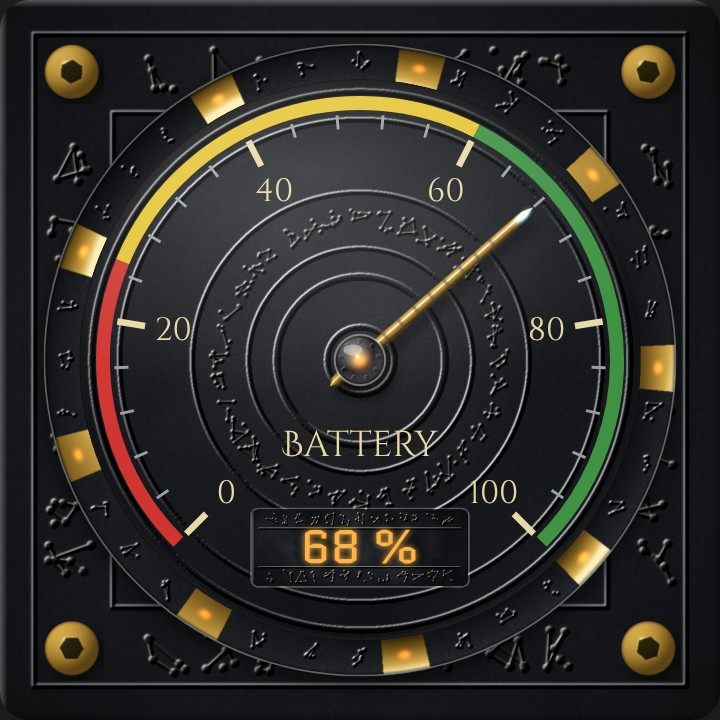
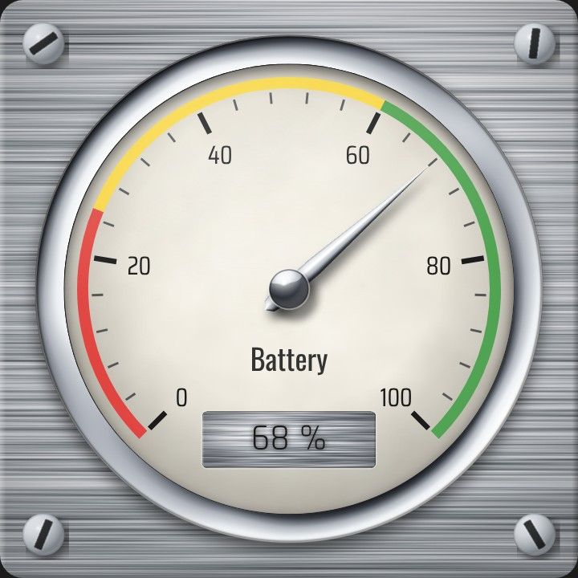
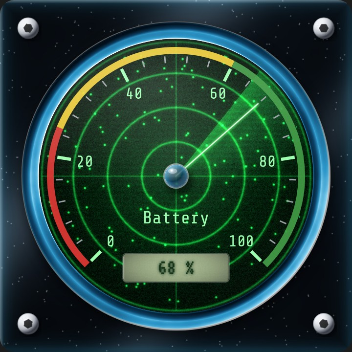
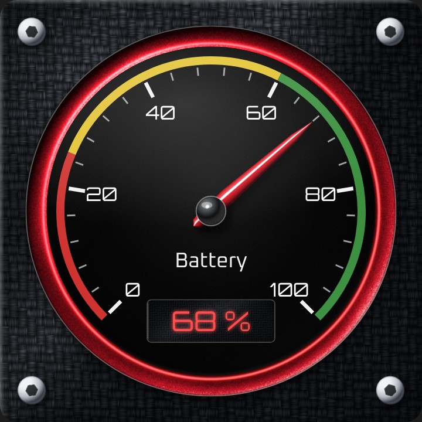
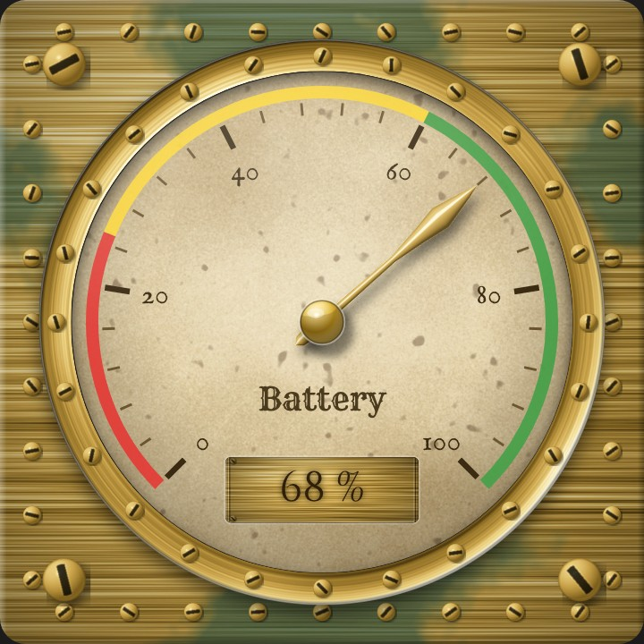
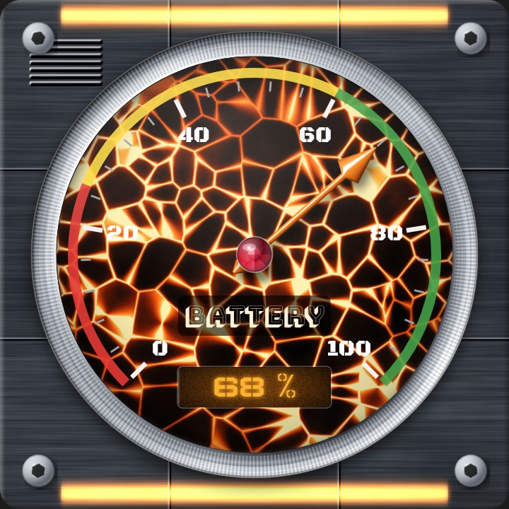

# Photoreal Gauge image pack

60 images for the Photoreal Gauge Card: 10 options for each of the 6 places the card accepts a picture. They cover metal, brushed metal, plastic, glass, a Stargate-style set, and some fun extras (wood, brass steampunk, radar, lava, sci-fi panels, leather).



All images were generated procedurally (lighting, texture and bevel rendering done in code), so they are original artwork you can use freely. The Stargate-style set is an original homage: its glyphs are invented constellation-style symbols and it is not affiliated with or taken from the TV series.

## Install

**With HACS** the pack ships inside the card's `dist` folder, so every picture is already available at
`/hacsfiles/photoreal-gauge-card/photoreal-gauge-images/<folder>/<file>`.

**Manual install:** copy the whole `dist` folder contents into `/config/www/photoreal-gauge-card/` and use `/local/photoreal-gauge-card/photoreal-gauge-images/<folder>/<file>` instead.

Paste the address into the matching image field of the card (examples below).

## What goes where

| Folder | Card field (YAML key) | Size | Notes |
|---|---|---|---|
| `Square_backgrounds` | Square image URL (`square_image`) | 1024 x 1024 JPG | The plate behind the dial, with corner screws and bevel. |
| `Dial_faces` | Circle image URL (`circle_image`) | 1024 x 1024 JPG | The round dial face. Ticks and numbers are drawn on top, so choose tick and number colors that contrast (see examples). |
| `Outer_rings` | Ring image URL (`border_image`) | 1024 x 1024 JPG | Replaces the generated ring. Only the outer band shows, so the ring thickness setting changes how much is visible. |
| `Needles` | Needle image URL (`needle_image`) | 128 x 768 transparent PNG | Also set **Needle type** to **Image**. They are drawn for the default Needle length 82 and tail 14, with the pivot at the right spot. Width is **Needle image width** (default 16). |
| `Hubs` | Hub image URL (`hub_image`) | 512 x 512 transparent PNG | The cap in the middle. Size is **Hub size**. |
| `Label_and_display_backgrounds` | Background image URL (`bg_image`) | 768 x 288 JPG | For text labels and digital displays. Set **Background opacity** to 1 to see them fully. |

A preview sheet of every folder is in `_previews/`.

The glowing needle tip is **off by default**. Turn on **Needle tip glow** in the editor (`needle_tip_glow: true`) if you want it.

## The options

**Square_backgrounds**: also the three original starter backgrounds (`carbon-graphite-screws`, `dark-brushed-metal-screws`, `dark-brushed-metal`). New: 01 polished steel, 02 brushed aluminum, 03 black anodized, 04 carbon fiber, 05 matte black plastic, 06 smoked glass, 07 Stargate stone with glyph border, 08 brass steampunk, 09 walnut wood, 10 sci-fi bulkhead.

**Dial_faces**: 01 white enamel, 02 matte black, 03 turned silver, 04 carbon fiber, 05 blue glass, 06 vintage cream, 07 Stargate stone disc, 08 brass sunburst, 09 radar green, 10 lava cracks.

**Outer_rings**: 01 chrome, 02 brushed steel, 03 gold, 04 copper with patina, 05 black knurled plastic, 06 blue glass, 07 Stargate chevron ring, 08 knurled steel, 09 riveted brass, 10 red neon anodized.

**Needles**: also `sample-needle.png`. New: 01 chrome pointer, 02 red plastic, 03 brass spear, 04 carbon with red tip, 05 blue glass, 06 orange arrow, 07 Stargate bronze with crystal tip, 08 white ceramic, 09 neon green line, 10 steel sword.

**Hubs**: 01 chrome dome, 02 brass dome, 03 black plastic dome, 04 glass dome, 05 knurled steel cap, 06 slotted screw head, 07 Stargate crystal core, 08 carbon fiber dome, 09 ruby jewel, 10 wood and brass.

**Label_and_display_backgrounds**: 01 brushed steel plate, 02 black plastic, 03 frosted glass, 04 green LCD, 05 amber display, 06 brass plate, 07 Stargate stone glyphs, 08 carbon fiber, 09 stitched leather, 10 sci-fi blue panel.

## Tips

- Mix and match freely. Every image in a folder is the same size and style of use.
- Square and dial images are plain JPGs, so they also work in other cards.
- To tint a dark dial face lighter or darker, lower **Circle image opacity**.
- Needle PNGs keep their transparency, so threshold colors do not recolor them. For a needle that follows the threshold color, use the built-in needle types.


## Ready-made themes

Each theme combines pictures from this pack with a matching font from the `fonts` folder (see `fonts/README.md`). Paste into the card's YAML editor and change `entity`. The `font_urls` line loads the bundled fonts.

### Stargate style: stone, glyphs, bronze crystal needle



```yaml
type: custom:photoreal-gauge-card
entity: sensor.your_entity
name: Battery
gauge_margin: 6
thresholds:
- from: 0
  to: 25
  color: '#e53935'
- from: 25
  to: 60
  color: '#fdd835'
- from: 60
  to: 100
  color: '#43a047'
font_urls:
- /hacsfiles/photoreal-gauge-card/fonts/fonts.css
number_font: Cinzel
square_image: /hacsfiles/photoreal-gauge-card/photoreal-gauge-images/Square_backgrounds/07-stargate-stone-glyphs.jpg
circle_image: /hacsfiles/photoreal-gauge-card/photoreal-gauge-images/Dial_faces/07-stargate-stone-disc.jpg
border_image: /hacsfiles/photoreal-gauge-card/photoreal-gauge-images/Outer_rings/07-stargate-chevron-ring.jpg
needle_type: image
needle_image: /hacsfiles/photoreal-gauge-card/photoreal-gauge-images/Needles/07-stargate-bronze-crystal.png
needle_image_width: 16
hub_image: /hacsfiles/photoreal-gauge-card/photoreal-gauge-images/Hubs/07-stargate-crystal-core.png
digitals:
- y: 76
  width: 30
  font: Quantico
  font_size: 6.5
  color: '#ffb347'
  bg_image: /hacsfiles/photoreal-gauge-card/photoreal-gauge-images/Label_and_display_backgrounds/07-stargate-stone-glyphs.jpg
  bg_opacity: 1
labels:
- text: '{name}'
  x: 50
  y: 62
  size: 5
  font: Cinzel Decorative
  color: '#e8d9a8'
major_tick_color: '#e8d9a8'
number_color: '#e8d9a8'
```

### Chrome and white enamel



```yaml
type: custom:photoreal-gauge-card
entity: sensor.your_entity
name: Battery
gauge_margin: 6
thresholds:
- from: 0
  to: 25
  color: '#e53935'
- from: 25
  to: 60
  color: '#fdd835'
- from: 60
  to: 100
  color: '#43a047'
font_urls:
- /hacsfiles/photoreal-gauge-card/fonts/fonts.css
number_font: Saira Condensed
square_image: /hacsfiles/photoreal-gauge-card/photoreal-gauge-images/Square_backgrounds/02-brushed-aluminum.jpg
circle_image: /hacsfiles/photoreal-gauge-card/photoreal-gauge-images/Dial_faces/01-white-enamel.jpg
border_image: /hacsfiles/photoreal-gauge-card/photoreal-gauge-images/Outer_rings/01-chrome.jpg
needle_type: image
needle_image: /hacsfiles/photoreal-gauge-card/photoreal-gauge-images/Needles/01-chrome-pointer.png
needle_image_width: 16
hub_image: /hacsfiles/photoreal-gauge-card/photoreal-gauge-images/Hubs/01-chrome-dome.png
digitals:
- y: 76
  width: 30
  font: Rajdhani
  font_size: 6.5
  color: '#1a1a1a'
  bg_image: /hacsfiles/photoreal-gauge-card/photoreal-gauge-images/Label_and_display_backgrounds/01-brushed-steel-plate.jpg
  bg_opacity: 1
labels:
- text: '{name}'
  x: 50
  y: 62
  size: 5
  font: Oswald
  color: '#333333'
number_color: '#1a1a1a'
major_tick_color: '#1a1a1a'
minor_tick_color: '#555555'
```

### Radar green on smoked glass



```yaml
type: custom:photoreal-gauge-card
entity: sensor.your_entity
name: Battery
gauge_margin: 6
thresholds:
- from: 0
  to: 25
  color: '#e53935'
- from: 25
  to: 60
  color: '#fdd835'
- from: 60
  to: 100
  color: '#43a047'
font_urls:
- /hacsfiles/photoreal-gauge-card/fonts/fonts.css
number_font: Share Tech Mono
square_image: /hacsfiles/photoreal-gauge-card/photoreal-gauge-images/Square_backgrounds/06-smoked-glass.jpg
circle_image: /hacsfiles/photoreal-gauge-card/photoreal-gauge-images/Dial_faces/09-radar-green.jpg
border_image: /hacsfiles/photoreal-gauge-card/photoreal-gauge-images/Outer_rings/06-blue-glass.jpg
needle_type: image
needle_image: /hacsfiles/photoreal-gauge-card/photoreal-gauge-images/Needles/09-neon-green-line.png
needle_image_width: 16
hub_image: /hacsfiles/photoreal-gauge-card/photoreal-gauge-images/Hubs/04-glass-dome.png
digitals:
- y: 76
  width: 30
  font: VT323
  font_size: 6.5
  color: '#16351a'
  bg_image: /hacsfiles/photoreal-gauge-card/photoreal-gauge-images/Label_and_display_backgrounds/04-green-lcd.jpg
  bg_opacity: 1
labels:
- text: '{name}'
  x: 50
  y: 62
  size: 5
  font: Share Tech Mono
  color: '#9dffb0'
number_color: '#9dffb0'
major_tick_color: '#9dffb0'
```

### Carbon fiber and red racing



```yaml
type: custom:photoreal-gauge-card
entity: sensor.your_entity
name: Battery
gauge_margin: 6
thresholds:
- from: 0
  to: 25
  color: '#e53935'
- from: 25
  to: 60
  color: '#fdd835'
- from: 60
  to: 100
  color: '#43a047'
font_urls:
- /hacsfiles/photoreal-gauge-card/fonts/fonts.css
number_font: Orbitron
square_image: /hacsfiles/photoreal-gauge-card/photoreal-gauge-images/Square_backgrounds/04-carbon-fiber.jpg
circle_image: /hacsfiles/photoreal-gauge-card/photoreal-gauge-images/Dial_faces/02-matte-black.jpg
border_image: /hacsfiles/photoreal-gauge-card/photoreal-gauge-images/Outer_rings/10-red-neon-anodized.jpg
needle_type: image
needle_image: /hacsfiles/photoreal-gauge-card/photoreal-gauge-images/Needles/02-red-plastic.png
needle_image_width: 16
hub_image: /hacsfiles/photoreal-gauge-card/photoreal-gauge-images/Hubs/03-black-plastic-dome.png
digitals:
- y: 76
  width: 30
  font: Orbitron
  font_size: 6.5
  color: '#ff4d4d'
  bg_image: /hacsfiles/photoreal-gauge-card/photoreal-gauge-images/Label_and_display_backgrounds/08-carbon-fiber.jpg
  bg_opacity: 1
labels:
- text: '{name}'
  x: 50
  y: 62
  size: 5
  font: Oxanium
  color: '#f0f0f0'
```

### Brass steampunk



```yaml
type: custom:photoreal-gauge-card
entity: sensor.your_entity
name: Battery
gauge_margin: 6
thresholds:
- from: 0
  to: 25
  color: '#e53935'
- from: 25
  to: 60
  color: '#fdd835'
- from: 60
  to: 100
  color: '#43a047'
font_urls:
- /hacsfiles/photoreal-gauge-card/fonts/fonts.css
number_font: IM Fell English SC
square_image: /hacsfiles/photoreal-gauge-card/photoreal-gauge-images/Square_backgrounds/08-brass-steampunk.jpg
circle_image: /hacsfiles/photoreal-gauge-card/photoreal-gauge-images/Dial_faces/06-vintage-cream.jpg
border_image: /hacsfiles/photoreal-gauge-card/photoreal-gauge-images/Outer_rings/09-riveted-brass.jpg
needle_type: image
needle_image: /hacsfiles/photoreal-gauge-card/photoreal-gauge-images/Needles/03-brass-spear.png
needle_image_width: 16
hub_image: /hacsfiles/photoreal-gauge-card/photoreal-gauge-images/Hubs/02-brass-dome.png
digitals:
- y: 76
  width: 30
  font: Cinzel Decorative
  font_size: 6.5
  color: '#2e1f0a'
  bg_image: /hacsfiles/photoreal-gauge-card/photoreal-gauge-images/Label_and_display_backgrounds/06-brass-plate.jpg
  bg_opacity: 1
labels:
- text: '{name}'
  x: 50
  y: 62
  size: 5
  font: Rye
  color: '#4a3a1e'
number_color: '#3a2a12'
major_tick_color: '#3a2a12'
minor_tick_color: '#6b5530'
```

### Lava and sci-fi bulkhead



```yaml
type: custom:photoreal-gauge-card
entity: sensor.your_entity
name: Battery
gauge_margin: 6
thresholds:
- from: 0
  to: 25
  color: '#e53935'
- from: 25
  to: 60
  color: '#fdd835'
- from: 60
  to: 100
  color: '#43a047'
font_urls:
- /hacsfiles/photoreal-gauge-card/fonts/fonts.css
number_font: Black Ops One
square_image: /hacsfiles/photoreal-gauge-card/photoreal-gauge-images/Square_backgrounds/10-scifi-bulkhead.jpg
circle_image: /hacsfiles/photoreal-gauge-card/photoreal-gauge-images/Dial_faces/10-lava-cracks.jpg
border_image: /hacsfiles/photoreal-gauge-card/photoreal-gauge-images/Outer_rings/08-knurled-steel.jpg
needle_type: image
needle_image: /hacsfiles/photoreal-gauge-card/photoreal-gauge-images/Needles/06-orange-arrow.png
needle_image_width: 16
hub_image: /hacsfiles/photoreal-gauge-card/photoreal-gauge-images/Hubs/09-ruby-jewel.png
digitals:
- y: 76
  width: 30
  font: Wallpoet
  font_size: 6.5
  color: '#ffb02e'
  bg_image: /hacsfiles/photoreal-gauge-card/photoreal-gauge-images/Label_and_display_backgrounds/05-amber-display.jpg
  bg_opacity: 1
labels:
- text: '{name}'
  x: 50
  y: 62
  size: 5
  font: Bungee Shade
  color: '#fff1d6'
  bg_color: '#000000'
  bg_opacity: 0.6
  padding: 0.8
  radius: 1.2
```

